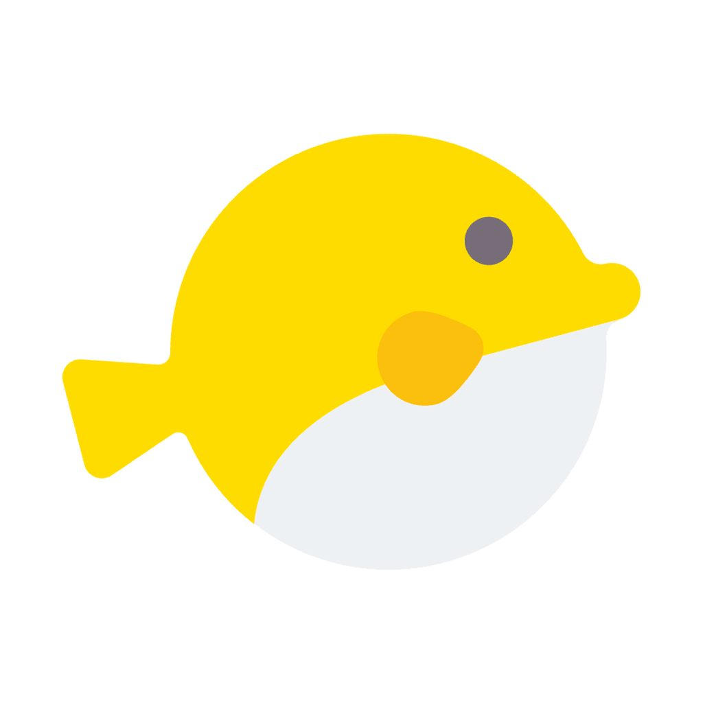
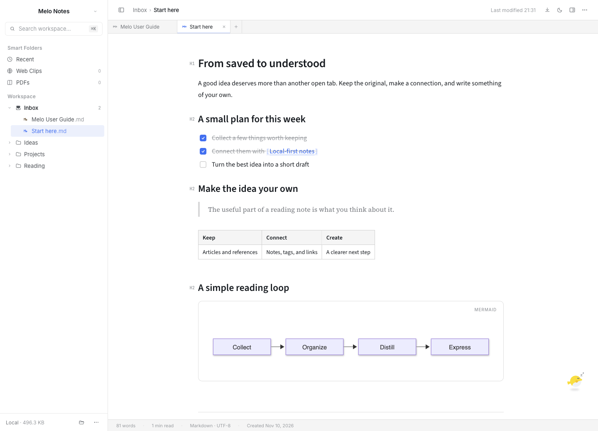
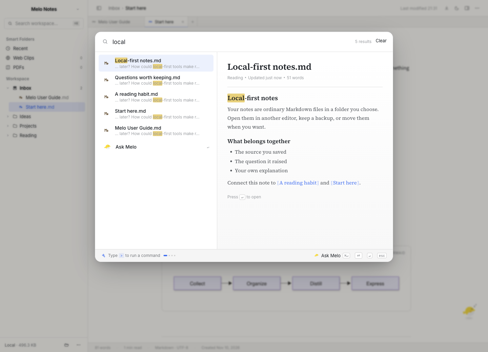
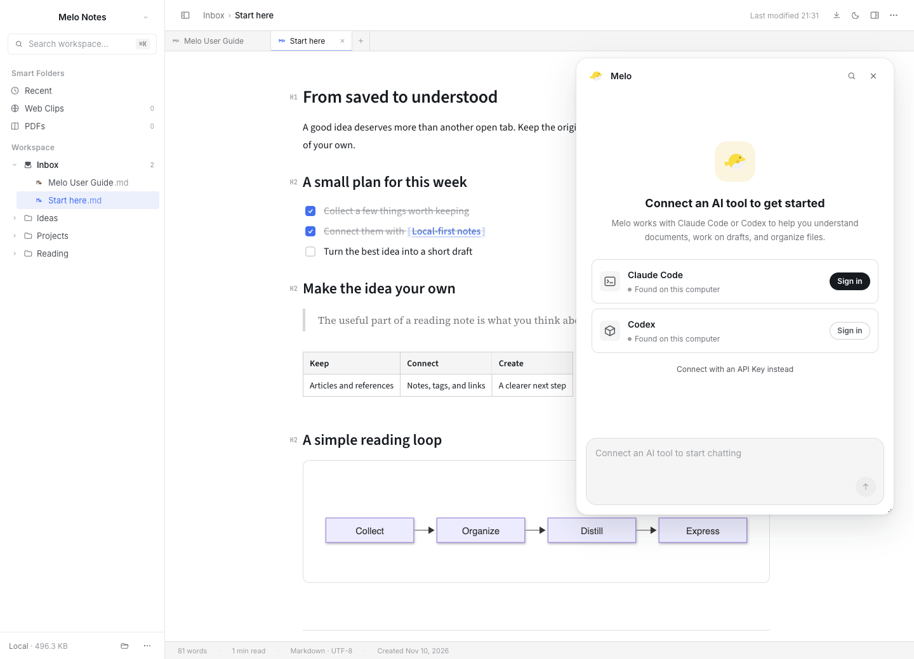

<p align="center">
  
</p>

<h1 align="center">Melo</h1>

<p align="center"><strong>Notes you own. An AI companion when you need one.</strong></p>
<p align="center">A local-first Markdown workspace for reading, thinking, and writing.</p>

<p align="center">
  <a href="https://github.com/melo-libs/melo/releases/latest"></a>
  <a href="https://github.com/melo-libs/melo/actions/workflows/ci.yml"></a>
  <a href="LICENSE"></a>
</p>

<p align="center">
  <a href="https://github.com/melo-libs/melo/releases/latest">Download for macOS</a> ·
  <a href="https://www.melolib.com">Website</a> ·
  <a href="README.zh-CN.md">简体中文</a> ·
  <a href="https://github.com/melo-libs/melo/discussions">Discussions</a>
</p>

<picture>
  <source media="(prefers-color-scheme: dark)" srcset="docs/images/workspace-dark.png">
  
</picture>

<p align="center"><sub>Real app screenshots with example notes, captured from main.</sub></p>

Melo keeps your notes as plain `.md` files in a folder you choose. Save articles, connect ideas, and turn what you read into something of your own. Open an existing notes folder or a single Markdown file; your files stay in their original location.

When you want help, open **Ask Melo** beside your document. Connect Claude Code or Codex to understand an article, work on a draft, or organize files together. AI is optional; writing, reading, and organizing your notes do not require a Melo account.

## A workspace for the whole reading loop

Melo follows **CODE: Collect, Organize, Distill, Express**.

|              | What you can do                                                                                            |
| ------------ | ---------------------------------------------------------------------------------------------------------- |
| **Collect**  | Clip web articles with their source and images. Keep PDFs, images, audio, and video alongside your notes.  |
| **Organize** | Use folders, tags, Smart Folders, and `[[wikilinks]]`. Follow backlinks and explore the local graph.       |
| **Distill**  | Read without clutter, search across your workspace, and ask Melo about the document or a selected passage. |
| **Express**  | Write in a WYSIWYG Markdown editor, refine a draft with AI, and export to Markdown, HTML, or PDF.          |

### Write without leaving Markdown behind

Headings, task lists, quotes, tables, highlighted code blocks, and LaTeX equations appear as you type. Use `/` to insert a block, drag the handle to reorder it, or select text for formatting and links.

Mermaid diagrams support source editing, inline zoom and pan, and copying either the complete image or its code. Ordinary images share the same inline viewing controls. Both features are on `main`; they are **not included in v2.1.3**.

### Find the note, keep your place

Press `⌘K` to search titles and full text with a live preview. Narrow results with `#tag`, `kind:pdf`, or `path:Inbox`. Paste a URL into the same palette to clip an article, or carry a question into Ask Melo.



### Bring your own AI connection

Melo works with **Claude Code and Codex** through ACP. Reuse a tool already installed on your Mac, or let Melo download the required components when you connect. Sign in with a supported account, or configure an API key compatible with the selected tool.

- The current document, selected text, files, and screenshots can become conversation context.
- Review proposed document and file changes through Melo's permission flow.
- Connection settings verify API credentials before saving a replacement.
- API keys saved by Melo use the computer's secure storage.

Notes are stored locally. Using AI sends the relevant context to the service you connect; local storage does not make AI requests offline.

<details>
<summary>See the AI connection screen</summary>



See [supported API connections](docs/agent-api-providers.md) for protocol requirements and provider details.

</details>

### Keep your files yours

- Notes remain ordinary Markdown files; images live under `.assets/` with relative paths.
- Changes made in another editor are picked up live.
- Search uses a rebuildable index in `.melo/`; your notes are not stored in that index.
- English and Simplified Chinese interfaces, with light, dark, and system themes.
- No built-in cloud sync or automatic backup. Back up the whole workspace, including `.assets/` and `.melo/`.

## Download and get started

Published builds are currently available for **macOS**.

| Your Mac                     | Download from [the latest release](https://github.com/melo-libs/melo/releases/latest) |
| ---------------------------- | ------------------------------------------------------------------------------------- |
| Apple silicon — M1 and later | The DMG ending in `-arm64.dmg`                                                        |
| Intel                        | The DMG ending in `-x64.dmg`                                                          |

1. Open the DMG and move Melo into Applications.
2. Choose a workspace folder, or open a Markdown file.
3. Start writing. Connect an AI tool from the pufferfish button whenever you want help.

macOS releases are self-signed and **not notarized by Apple**. On first launch, macOS may ask you to allow Melo in **System Settings → Privacy & Security**. Releases from 2.0.2 onward support in-app updates; users on 2.0.1 or earlier need one manual installation first.

This README follows `main`. Check the [release notes](https://github.com/melo-libs/melo/releases) for the features in your installed version.

## Useful shortcuts

| Shortcut     | Action                                        |
| ------------ | --------------------------------------------- |
| `⌘K`         | Search, run a command, or paste a URL to clip |
| `⌘⇧C`        | Copy the editor selection as Markdown         |
| `⌘N`         | Start a new note                              |
| `⌘S`         | Save a draft; saved notes then autosave       |
| `⌘F` / `⌥⌘F` | Find / replace in the current note            |
| `/`          | Insert a block on an empty line               |
| `[[`         | Link to another note                          |
| `⌘,`         | Open preferences                              |

The [in-app user guide](src/renderer/src/assets/guides/melo.en.md) has more examples.

## Build and contribute

Melo uses Electron, React, TypeScript, Tiptap / ProseMirror, and Jotai. Use **Node.js 24** and the pnpm version pinned in `package.json`.

```sh
corepack enable
pnpm install
pnpm run dev
```

```sh
pnpm run lint          # ESLint and formatting checks
pnpm run typecheck     # Main, preload, and renderer
pnpm test             # Unit tests
pnpm run build        # Typecheck and production build
```

Development runs use a separate **Melo Dev** profile. Set `MELO_USER_DATA` to use an isolated profile. CI checks macOS arm64 and x64; publishing a release is a separate step.

Read the [contribution guide](CONTRIBUTING.md), [architecture notes](AGENTS.md), and [macOS release guide](docs/mac-release.md). Report a [bug](https://github.com/melo-libs/melo/issues/new?template=bug_report.yml), propose a [feature](https://github.com/melo-libs/melo/issues/new?template=feature_request.yml), or ask a question in [Discussions](https://github.com/melo-libs/melo/discussions).

## License

[MIT](LICENSE) © 2026 Melo Labs.
